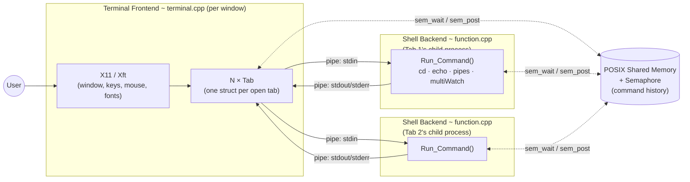
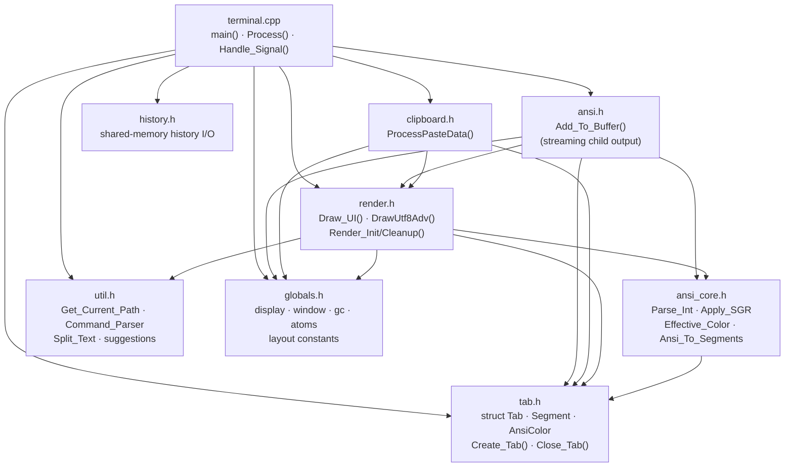

# 📄 Design Document: Custom Terminal Emulator

## 1. Introduction

### **1.1 Goal Of This Project**

The primary goal of this project is to create a lightweight, custom terminal emulator for X11 environments. It aims to provide essential terminal functionality, including command execution, I/O handling, and a tabbed user interface, with a strong focus on custom shell features like history and multi-process monitoring.

### **1.2 System Architecture**

#### The system employs a two-process architecture:

- **Terminal Frontend(terminal.cpp):** The main process responsible for creating the X11 window, handling UI drawing (tabs, text buffer), managing user input (keypresses, mouse clicks), and communicating with the shell process via pipes.
- **Shell Backend(function.cpp):** The child process that acts as the custom shell. It is responsible for parsing commands, executing external programs (via execvp), managing I/O redirection, piping, and handling built-in commands like cd, echo, history, and multiWatch.

These two components communicate primarily through pipes for standard I/O and POSIX Shared Memory/Semaphores for inter-process history synchronization. **Note:** this is a plain `pipe()`, not a real pseudo-terminal (pty) ~ that was a deliberate choice, see section 3.9.



### **1.3 Module Layout**

As `terminal.cpp` grew it was split into header modules (same header-only convention already used by `headers/tab.h`, `headers/util.h`, `headers/history.h`, each is included exactly once, by a single `.cpp`, so there's no separate compilation/linking step, and the Makefile didn't need to change):

- `headers/globals.h` ~ shared X11 display / window / atom handles and UI layout constants.
- `headers/render.h` ~ Xft / font setup and teardown, the Unicode font-fallback drawing code, and `Draw_UI()`.
- `headers/ansi_core.h` ~ dependency-free SGR primitives (`Apply_SGR`, `Effective_Color`, `Ansi_To_Segments`) shared by `ansi.h` and `render.h`.
- `headers/ansi.h` ~ the streaming ANSI / SGR parser for child-process output, `Add_To_Buffer()`.
- `headers/clipboard.h` ~ `Ctrl+V` paste / X selection handling.
- `terminal.cpp` ~ now just `main()` (X11 bring-up), `Process()` (the event loop), and `Handle_Signal()`.



## 2. Terminal FrontEnd

### **2.1 Base UI using X11 ~**

#### There are various library to create UI in C++, one of them is X11

- First I go through this documentation [`X11 Documentation`](https://tronche.com/gui/x/xlib/). Here I came to know about the functions for Creating Window, Display and Destroying them.
- Then The Question Came That How Can I Write into that. For this I also found functions like `XDrawString`.
- But what I pressed In the keyboard that must need to go to my terminal but how will I do that. Then again going through the X11 documentation. I find the solution `XNextEvent` which take all the event signal like Pressing a Keyboard Button, Mouse Click, Resizing Window, Expose Window etc.
- But we need multiline input to be printed. Therefore I used vector for this and it will store all the line as a string into that vector and in every render we will print all the line.
- By listening to this event we will add the char we press in a temporary string `line` until we hit enter. after hitting enter the temporary string is store into a vector of strings `buffer`.
- Also just like real terminal I want to add prefix like `user@hostname:` for that I came search a little bit and find there are inbuilt functions for this.
- So, for each line when adding to the buffer of lines I add this prefix before the temporary string.

### **2.2 Multitab Functionality ~**

#### This is a important feature of a Tab along with that we can easily understand that each tab will be there own.

- Each each tab will be their own they all have their own data structure for this I use `Struct`. Globally a vectors of `struct Tab` will be there.

  ```bash
  struct Tab {
     pid_t child_pid;

     bool is_alive = false;
     bool is_search = false;
     bool is_autocomplete = false;

     int fd_read = -1;           // Need of all items of struct Tab
     int fd_write = -1;          // are mentioned Later
     int scroll_index = 0;
     int writing_index = 0;
     int history_index = -1;

     string line = "";
     string temp = "";
     string title = "";

     vector<string> buffer;
     vector<string> suggestions;
  };
  ```
- First I can't understand how to create a tab process. Then after some searching I came to know about `fork() + exec()` paradigm which I use to create a new tab.
- We use `fork()` for creating a child process and then `exec()` to replace the whole process with a new code that we want to run.
- Now what to run in there is the main dillema that I face. first I can to know that if I pass `"bin/shell"` then each tab will behave as a real terminal. Therefore there will be no need of backend.
- Then there will be no meaning of doing this project. Then I though that I will create a seperate `.cpp` file which will contain the commands that we want to run.
- Now there is one problem I face that after adding Keypress Event that it is not showing anything. To this solve this issue I came to know about system calls like `dup`, `dup2`, `pipe` which is needed for redirection of input and output.
- So, as our terminal is running as a child process we need to create a `pipe` where one end is for read and another is for write. Also we need to use `dup` for copying `STDIN_FILENO` or `STDOUT_FILENO` to the pipes ends.
- Now If child process write something into the pipe how are we supposed to get this. for this we use another system call `poll` for checking If any child process has write something or not between a fixed interval of time.

### **2.3 Multitab UI ~**

#### Obiously each tab will be their own with their own process IDs but things like search history must be linked together.

- I think of just like any real browser or terminal all tabs along with a close button will be at top of the screen and at the end there will be plus button to add new tab.
- Now at a time there can be only one Active Tab therefore we have globally declared a varibale for knowing which tab is active.
- As all operations wiil be done on an active tab it is very important to to handle it correctly.
- Using the KeyPress Event Initially I create four functionalities just like normal tab -

  ```bash
    Ctrl + T = Create New Tab
    Ctrl + W = Close Active Tab
    Ctrl + -> = Go To Next Tab If Present Otherwise Go To First Tab
    Ctrl + <- = Go To Previous Tab If Present Otherwise Go To Last Tab
  ```
- But I forgot to add a check that there should be minimum one Tab otherwise whole program will crash. Then I add this check to prevent this.
- Along with that it also need to create a new tab when click into the plus button and delete this when click into cross button.
- To implement click functionality i search a bit in doument and find that we need to use `ButtonPress` event to indentify in which position of the screen mouse is clicked.
- Using the position and size of the plus button I check whether we press on the wright position or not.
- For Rendering the plus button in correct position we need to make sure the numbers of tabs and width of each tab box.

### **2.4 Cursor Functionality ~**

- Just like any real terminal or editor there is a cursor to position where the character will be printed and it is very essential for good user experience.
- My simple thought was to to represent the writing poistion represented as `writing_index` an index of the temporary string `line`.
- But we also need to render the cursor at the correct position with need the X, Y coordinate of the editing position.
- Simple thought X can be find in what number of line we multiplied with the line height. But for Y first thought to multiply the `writing_index` position with the character width. Which Don't work properly.
- Then I realize all characters width are not same therefore I have to consider whole string width for this I found a X11 function `XTextWidth` for this.
- Also by pressing `Ctrl + A` we place the cursor to the start and `Ctrl + E` to place the cursor at the end.
- Just time real terminal when stop giving input for certain amout of time the cursor stop blinking. similar to that `5000ms` after stop giving input the cursor will not blink.

### **2.5 Vertical Scrolling ~**

#### Scrolling is necessary feature otherwise we can't see what input we give or what output we get which is bad user experience.

- Similar to `writing_index` I think of a `scrolling_index` which will keep track of from which line we start rendering.
- Then I also understand when there will be need of scrolling? When the total contents line height will be more than screen height that we should update the scrolling index.
- I Keep track of this by dividing screen height by line height to get the max number of line it can support and beyond that I need to start rendering from scrolling_index.
- Also, I need interactivity when I use mouse for scrolling or using page up and page down button. For this I use `Keypress` and `Buttonpress` events.
- But I face problem when I resizing my display screen as I fixed my screen height and width and don't re-rendering the content when resizing.
- How to know that I am resizing for that I search a little bit and find and event called `ConfigureNotify`. When we resize this event triggers. So, in this event I update the window height and width then render it immediately.

### **2.6 Shell Prompt ~**

#### The standard format seen in every terminal is often represented as `[USERNAME]@[HOSTNAME]:[PATH][SYMBOL]` is known as Shell Prompt.

- Now Username and Hostname may not change but we frequently change our working directory path. Individual Tab Can Work on different path.
- I faced this problem the path is changing when using `cd` command but I cannot show it into the Shell Prompt
- The problem I easily find out that each tab is a child process path changing is happening in child process but parents path has not changed.
- But how to solve it first I thought to create a shared memory where I will keep all the Tabs and in each tab I will create a variable to store current working directory.
- I tried to implement this but I faced several errors then I understand Shared Memory can only be of fixed size it can't be of dynamic size but our tab will be dynamic therefore I need to discard the idea.
- Then I took help from GPT and find an beautifull solution which is to use the child process id to get that child's current working directory.

### **2.7 ANSI/SGR Color Rendering ~**

- Child-process output is a plain byte stream, and colored tools (`ls --color`, `git`, `grep --color`) emit color as ANSI SGR escape sequences (`ESC [ params m`) embedded directly in that stream, so rendering color means parsing those sequences out before drawing anything.
- `headers/ansi_core.h` holds the dependency-free primitives: `Parse_Int` (reads an SGR parameter number), `Apply_SGR` (applies one `ESC [ ... m` parameter list to a running `color`/`bold` state, only foreground color and bold are modeled), and `Effective_Color` (bold is treated as "use the bright variant of the current color").
- `headers/ansi.h`'s `Add_To_Buffer` walks a tab's raw child output byte-by-byte, recognizing `ESC [ params m` and applying it via `Apply_SGR`, while other CSI sequences (cursor movement, erase, ...) and OSC sequences (window title, ...) are recognized just enough to be swallowed without corrupting the visible text ~ this terminal doesn't implement cursor addressing, so there's nothing meaningful to do with them yet. Text between escape sequences is grouped into colored `Segment{text, color}` runs (`Tab::buffer` is `vector<vector<Segment>>`, not `vector<string>`), and a 16-color ANSI palette is allocated once at startup as real `XftColor`s.
- Parser state (`raw_pending`, `current_color`, `current_bold`, `current_line`) persists on the `Tab` across separate `read()` calls, so an escape sequence or a multi-byte UTF-8 codepoint split across two pipe reads (`Split_Incomplete_Utf8`) still parses correctly on the next call.
- The same SGR primitives back a second, one-shot entry point, `Ansi_To_Segments`, used to color small in-memory strings (like the shell prompt built in `Get_Current_Path`) without the streaming/partial-sequence bookkeeping `Add_To_Buffer` needs for raw process output.
- **Known limitation:** since the shell talks to child processes over a plain `pipe()`, not a pseudo-terminal, `isatty(stdout)` is false from the child's point of view, so tools that *auto-detect* a non-tty and disable color on their own (most CLI tools, by default) stay uncolored unless forced (`ls --color=always`). This is a deliberate tradeoff of not adopting `forkpty()`/`openpty()`.

### **2.8 Unicode & Font-Fallback Rendering ~**

- A single `XftFont` can't cover every script, Devanagari, Bengali, Tamil, Arabic, CJK, and emoji glyphs each typically need their own dedicated font. `headers/render.h`'s `Render_Init()` opens every font in a fallback list (`font_name_list`) into `Font_List[]`, instead of stopping at the first one that opens successfully.
- `Utf8_Decode` is a hand-written UTF-8 decoder that reads one codepoint at a time from a `string`, returning how many bytes it consumed (always ≥ 1, even for invalid/truncated input, so the caller always makes forward progress).
- `DrawUtf8Adv` walks a string codepoint by codepoint, using `XftCharExists` to pick the first font in `Font_List` that actually contains each glyph, and groups consecutive codepoints that resolve to the same font into a single draw call for efficiency. Passing `draw == nullptr` measures the string's advance width (used for cursor placement, tab-title truncation) without actually drawing anything.
- This means a single rendered line including the built-in Devanagari search prompt (`एक दिन पहले...`), can freely mix scripts, and each glyph is drawn with whichever font in the fallback list actually supports it.

## 3. Shell Backend Design

### **3.1 Take Input ~**

#### Main problem is how can I get the input that is written by the parent.

- When creating a new tab we rediect the `STDIN_FILENO`, `STDOUT_FILENO` and `STDERR_FILENO` using the pipe.
- Therefore what we write in the Active Tab's write pipe end we will read it in the child in the pipe's other end.
- Now we want to take the input line by line therefore I use `getline` method to read line by line and executing each line.

### **3.2 Command Execution ~**

- I can't think about any idea how we gonna execute different commands. There can be method for some command like `cd`, `sort` but for all how to do that.
- After some research I found that using `execvp` command we can execute commands after creating a child process using `fork`.

  ```bash
  // For the command "ls -l" execute it as
  execvp("ls", ["ls", "-l", NULL])
  ```

### **3.3 Input and Output File Redirection ~**

- This is easy task using `dup2` and `dup` as we do it early for I/O redirection.
- As in regular terminal

  - `< Input_File_Name` for taking input from `Input_File_Name`.
  - `> Output_File_Name` for giving output from `Output_File_Name`.
  - `>> Append_File_Name` for append output from `Append_File_Name`.
- First we want to check any append file present or not if not then check output file. Check then for input file. If any file present then redirect in using `dup2` and `dup` system call.

### **3.4 `cd` Command Execution ~**

#### This is basic command which is frequesntly used in every terminal.

- I first think to use C++ filesystem for changing directory but after searching I found there is a inbuilt function in C++.
- In C++ `unistd.h` header file there is a function known as `chdir(const char* __path)` to change the current working directory to the given `__path`.
- If any error occurs then it will return a non-zero value otherwise it will return zero value.

### **3.5 `multiWatch` Command Execution ~**

#### This is a custom command which will executed as `multiWatch ["cmd1", "cmd2", "cmd3", ....]` which is similar to `watch` command.

- We will first seperate all the commands and execute all of them as a child process and store the child process id for kill all the process after execution.
- Individual process will write their output in a temporary hidden text file with the command name and unix timestamp.
- Use `poll` system call in parent process then in parent process we will read the output from that file and print it to the screen.
- Then the temporary hidden text file for all the child processes will be deleted from the directory.

### **3.6 `echo` Command Execution ~**

- As we have to take multiline unicode input we have to continue taking input untill we close quotation.
- Keep track when first `"` started that store into buffer untill faced end '"' mark.
- All the echo commands are working fine but command which access environmental variable like `echo "$HOME"` us not giving home directory output.
- Then I have to explicitely find the environmental variable and replace with variable value using `getenv()` function.

### **3.7 Pipe Command Execution ~**

#### Just like normal terminal it is executed as `cmd1 | cmd2 | cmd3 | ...` and output of one command will be considered as input for next command. The output of final command will be final.

- I use same concept of `pipe` where we create I/O connection between two process.
- Here easily we need to have `N - 1` number of pipes where Number of commands to be executed in N.
- Showing some example in the internet I create this pipe in an array of size 2 where `Zero Index` will be used for read and `First Index` will be used for write.
- As an example in the pipe between `cmd1` and `cmd2` zero index will be work as `STDIN_FILENO` for `cmd2` and first index will be working as `STDOUT_FILENO` for `cmd1`.

### **3.8 Interrupting Commands ~**

#### Using the concept of signal handling we want to integrate Interupt signal similar to Ctrl-C and Ctrl-Z.

- First I study about all the signal that is used in real systems. I find **27** such signals available.
- `Ctrl+C` generate `SIGINT` signal and `Ctrl+Z` generates `SIGTSTP` system call.
- So, My first thought is to capture the input from `KeyPress` event

  - if it is `Ctrl+C` then we sent the kill signal to the child process using `kill(pid, SIGINT)` system call.
  - if it is `Ctrl+Z` then we sent the kill signal to the child process using `kill(pid, SIGTSTP)` system call.
- Now in child process we will catch the signal and Handle it.

  - If we recieve `SIGINT` signal we will kill all the child processes, watch processes that are running in the terminal using `SIGKILL`or `SIGTERM` signal.
  - But for doing the same thing for `SIGTSTP` signal I can't do it properly. Mean the main tab process got terminated.
  - For this I search internet but I can't find any solution for this therefor I use GPT for this part.
  - From there I get an idea to using process grouping and keep the default Signal Handling behaviour for `SIGTSTP` in the child process by setting `signal(SIGTSTP, SIG_DFL)`.

### **3.9 Interactive Stdin Relay Protocol ~**

- A command with no `<` redirection still often needs to *read* stdin interactively like `cat`, `sort`, `wc`, a `read` loop. I understand that I have done echo using some `Cheatcode(Tracking opening and closing)` but this will not work same for all case since I can't figure how to send `EOF(Ctrl + D)` signal.  In this section I have used GPT to give any idea. The solution is preety intuitive is to gives such a command its own private pipe (`Interactive_Pipe`) instead of `/dev/null` or the shell's own long-lived interactive pipe directly.
- While that command is in the foreground (`g_foreground_pid > 0`), `main()`'s loop becomes a small multiplexer: it polls the shell's own stdin for anything the user types and relays it straight into the command's private pipe, while also polling (`WNOHANG`) for the command to exit, so it's never blocked exclusively on either one.
- Byte `0x04` (Ctrl+D) is handled specially in relay mode: instead of being forwarded as a literal data byte, it closes the private pipe's write end, which is what actually delivers real EOF to the running command.
- The backend also emits two control bytes around a foreground command's lifetime `0x01` right before it starts, `0x02` right after it ends that `headers/ansi.h`'s `Add_To_Buffer` intercepts (never rendered as visible text) to flip a per-tab `foreground_busy` flag. `terminal.cpp`'s `Process()` checks that flag to decide where keystrokes go: composing the next shell command line, or being sent straight to the running command (plain echoed into scrollback, no shell prompt, not added to history). The shell prompt itself is hidden by `Draw_UI` for the same reason while `foreground_busy` is set.
- **Deliberate limitation:** this is line-buffered interactivity, a full line reaches the child only when Enter is pressed not raw per-keystroke forwarding. Full-screen raw-mode programs (`vim`, `less`, a nested shell with its own arrow-key history) still won't work, since those need real tty semantics (line discipline, cursor addressing) that only a pseudo-terminal provides.

## 4. History Feature

### **4.1 Global History File ~**

#### First I search a little bit in the internet to find to how real terminal implement the history function

- So, I came to know they store history in a file named `.bash_history` in home directory.
- I follow up this technique to create a hidden file where I will store all the previous commands.

### **4.2 Local History File ~**

#### But as we know file reading everytime to fetch file for latest 1000 commands is expensive.

- I use a vector of string to store temporarily store and update history.
- Everytime we execute a command we will add that into the file along with local vector of strings. If its size has exceeded 1000 string we will remove the oldest one.
- But I face one problem I must have access to this temporary history data to all of the tabs.

### **4.3 Shared History File ~**

#### As we know we need to show all latest history command when executing `history` command.

- I first dumbly create a header file to declare the history vector and the operations like insertion, deletion and I import the header file in both file.
- But the thing is that it will create to different instance of history vector.
- To resolve this I then thoight of Shared Memory as I am limiting max size of shared memory.
- As using shared memory I also have to add semaphore.

### **4.4 History Buttons ~**

#### Just like real terminal pressing up arrow and down arrow we should change between commands

- For Showing which previous executed command to be shown we use an `history_index` to point in each tab.
- At very begining it is initialized as -1. After each step it will increased by 1 first then fetch.
- Now using `KeyPress` event when pressing

  - `Up Arrow` button will show the previous executed command if exist.
  - `Down Arrow` button will show to next command executed if exist.

### **4.5 Search History ~**

#### Searching into the history is a very useful functions used in everyday life.

- As per the instruction when pressing `Ctrl-R` it will open a search space to find command in history.
- How to know we are executing a search command functionality for this we use a boolean variable `is_search` for every tab.
- When `is_search` mode is on then we find the whole history file not the temporary history file

  - If the word exactly match then return those.
  - If partially match with length of longest common subsequence is > 2 then return those.
  - Otherwise return "Nothing found".

## 5. Autocomplete Feature

- First thing is to find all the file names present in the current working directory using C++ filesystem.
- Using an `is_autocomplete` bool variable to enable autocomplete mode. Also we will give suggestion only for the last word.
- Now as per the requirement when pressing `Tab` button -

  - If only one filename match with the last word we directly replace the last word.
  - If more than one suggestions present then it will be shown as a list of suggestions.
  - On pressing the correspondig number to the suggestion it will replace the last word with it.

## 6. Clipboard Feature

#### This is a bit of my interest to add this and we extend this more and more. Seeing a regular terminal I implement this.

- I thought to add something like `Paste` feature which will be done when pressing `Ctrl+v`.
- Now to implement this I came to know about another `XNextEvent` called `SelectionNotify`.
- Also in X11 there is a sub library called `XAtom` which is necessary to implement this.
- So, by merging this two I easily add this feature.

## 7. Fixes & Bug History

Everything above describes the design as it stands today. It didn't arrive that way ~ Unicode/font-fallback rendering (2.8), ANSI color parsing (2.7), the interactive-stdin relay protocol (3.9), the build system, and five `multiWatch`/`Ctrl+Z` process-management bugs were all found and fixed along the way, each with full root-cause analysis, the fix applied, and how it was verified.

See **[FIXES.md](FIXES.md)** for that complete log.

# Oviously the only limitation is our imagination. There is much more to do along with time.
